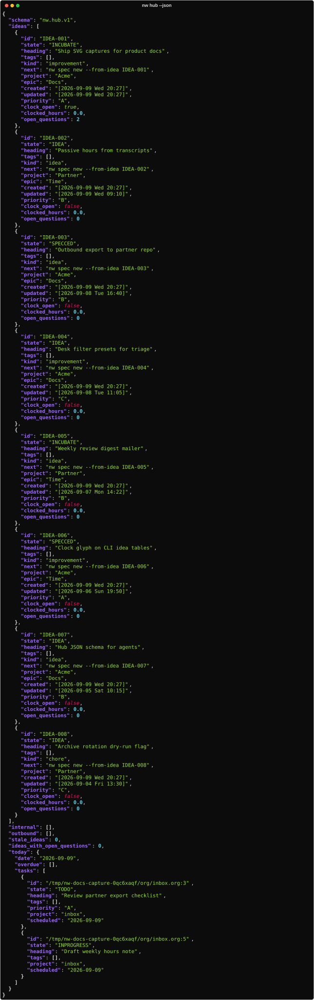

# Hub

Read-only **union triage**: open ideas, active internal specs, outbound outbox, plus a
tasks slice for today.

## When to use

Agent or human “what’s in flight?” without opening three lists. Never writes the ledger.

## Commands

```bash
nw hub --json                     # nw.hub.v1 (+ today tasks by default)
nw hub --json --project P         # filter ideas + today
nw hub --json --tasks-slice open  # capped open actionable tasks
nw hub --json --tasks-slice none  # ideas/specs only
nw hub --json --state TODO        # filter by state
```



`--json` is required in v1. Pair with [Ideas & next](ideas.md), [Skills](skills.md)
(`/nw-orient`), and the [Daily](../guides/daily-ops.md) / [Weekly](../guides/weekly-ops.md) ops guides.
