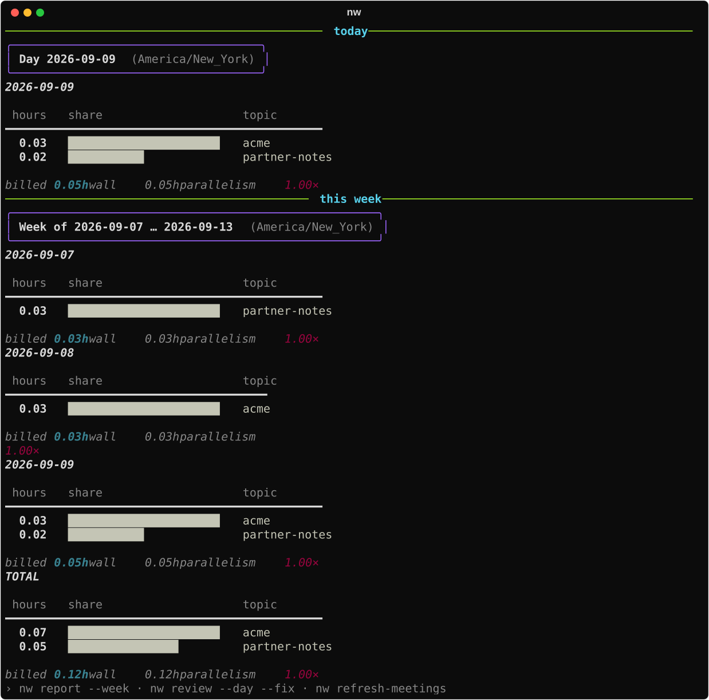
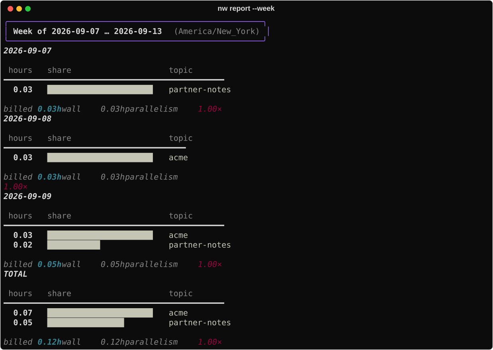
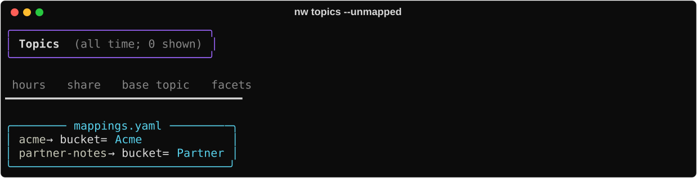

# Report & topics

Passive hours from transcripts (and meetings). No timer for this signal.

## When to use

Weekly review, mapping unknown topics, exporting a tidy dataset, preserving history
before Claude deletes transcripts.

## Commands

| Command | Role |
|---------|------|
| `nw` | Dashboard: today + this week (`--split` diagnostic) |
| `nw report` | Per-topic hours; `--week`, `--by AXIS`, `--last N`, `--md` |
| `nw topics` | Base topics + hours + facets; `--unmapped` |
| `nw map` | Attach facets: `nw map RAW project=Name` |
| `nw override` | Time-scoped reclassification for one session span |
| `nw review` | Segment timeline, unclassified inbox; `--fix` |
| `nw snapshot` | Archive past days to `history.jsonl` |
| `nw export` | CSV/JSON dataset of date/topic/hours/facets |
| `nw digest` | Hours joined to org tasks by JIRA key |

Workflow: [Track time](../guides/track-time.md) · [Weekly ops](../guides/weekly-ops.md).
