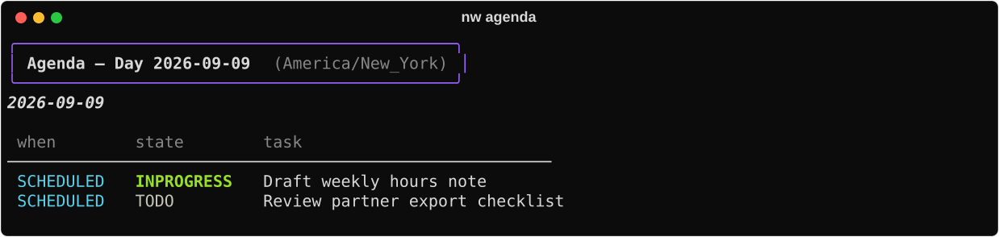
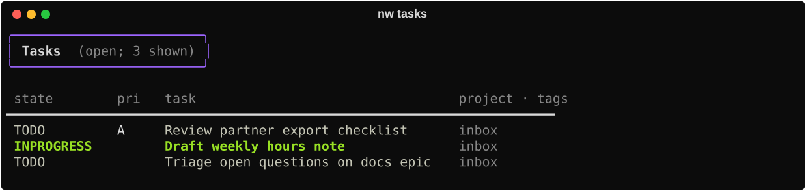

# Tasks & agenda

Org **actionable** work (distinct from idea seeds).

## When to use

Concrete TODOs with states, tags, schedule; morning agenda; marking done after generate.

## Commands

| Command | Role |
|---------|------|
| `nw tasks` | List open actionable tasks; filters `--state`, `--tag`, `--project`, … |
| `nw agenda` | SCHEDULED/DEADLINE over a date scope + overdue |
| `nw add TEXT` | Capture a new task into the capture file |
| `nw done SELECTOR` | Mark done |
| `nw state SELECTOR STATE` | Set TODO state |
| `nw digest` | Hours joined to tasks by JIRA key (also under [Report](report.md)) |

Selectors: `:ID:`, `file:line`, JIRA key, or heading substring. Ideas vs tasks: prefer
`nw idea` for seeds and `nw add` for actionable lines — see [Idea → ship](../guides/idea-to-ship.md)
and [Daily ops](../guides/daily-ops.md).
