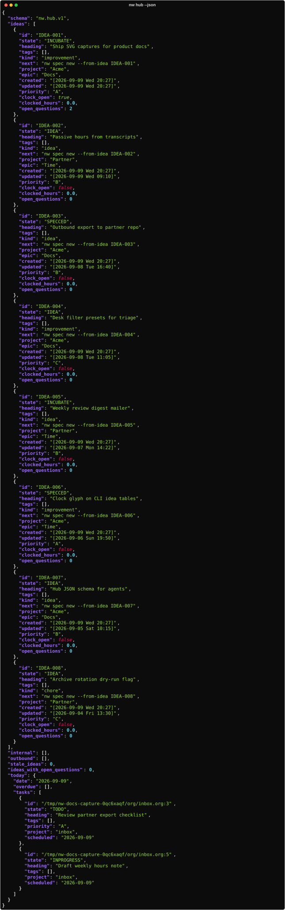

# Agent / automation surface

Front door for agents and scripts. Humans can stay on [Daily ops](daily-ops.md); agents
should install skills once, prefer `--json`, and treat verify/reconcile as the claim-done
path ([Lifecycle & DoD](../concepts/lifecycle.md)).

## Install skills

```bash
nw skills install                 # ~/.claude/skills (symlink)
nw skills list
nw skills install --dest ~/.cursor/skills
```

Getting started Path C: [Getting started](getting-started.md).

## Skill → CLI map

| Skill | Primary CLI | Stage |
|-------|-------------|-------|
| `/nw-orient` | `nw --help`, `nw hub --json`, `nw next --json` | Cold start |
| `/nw-capture` | `nw idea "…"` | Park a one-liner |
| `/nw-seed` | `nw idea` + `summary` / `log` | Distill a chat → idea |
| `/nw-related` | `nw ideas --query … --json` | Search before capture/promote |
| `/nw-explore` | `nw idea show\|summary\|questions\|log` | Enrich — **no** promote |
| `/nw-new-work` | `nw spec new --from-idea`, accept, ledger | Explored idea → accepted spec |
| `/nw-generate` | `nw spec generate` | Accepted **internal** SPEC → org tasks |
| `/nw-rework` | supersede / `seed-children` | Bad design or unfinished epic |
| `/nw-export` | `nw spec export` | Outbox portable → target repo |
| `/nw-implement-spec` | (in **target** repo) portable AC + tests | Build exported work |
| `/nw-verify` | `nw spec verify` (+ ledger / pull-status) | Post-hoc Definition of Done |
| `/nw-sheet-sync` | `nw sheet plan\|record --json` | Optional sheet triage |
| `/nw-conduct` | Monitor on `nw queue events --follow --for conductor`; `nw queue conduct-status\|resume`, `nw mailbox send` | Long-lived conductor woken by queue events |
| `/nw-steward` | Monitor on `nw mailbox follow --to steward:<P>`; `nw mailbox send` | Project steward answering the conductor |

Capability stub: [Skills](../capabilities/skills.md).

## JSON schema catalog

Every machine-readable command prints a top-level `"schema"` string. Prefer that over
scraping tables. Shapes below are illustrative — fields evolve; trust the live payload.

| Schema id | Command | Shape (sketch) |
|-----------|---------|----------------|
| `nw.hub.v1` | `nw hub --json` | `{schema, ideas[], internal[], outbound[], stale_ideas, …}` |
| `nw.ideas.v1` | `nw ideas --json` | `{schema, ideas:[{id,state,heading,next,…}]}` |
| `nw.ideas.search.v1` | `nw ideas --query … --json` | `{schema, query, ideas:[…]}` |
| `nw.next.v1` | `nw next --json` | `{schema, ideas:[{id,state,next,…}]}` |
| `nw.idea.v1` | `nw idea show ID --json` | `{schema, id, state, summary, questions, log,…}` |
| `nw.tasks.v1` | `nw tasks --json` | `{schema, tasks:[{id,state,heading,…}]}` |
| `nw.projects.v1` | `nw projects --json` | `{schema, projects:[{name,outbound,research,…}]}` |
| `nw.projects.add.v1` | `nw projects add … --json` | plan payload before mutating config |
| `nw.spec.verify.v1` | `nw spec verify … --json` | verify report (AC / tests / ledger drift) |
| `nw.spec.review.v1` | `nw spec review … --json` | `{schema, spec_id, verdict: approve\|revise\|split, spec_sha256, reviewed_at, model, cost_usd, findings[], suggested_splits[]}` (SPEC-0188) |
| `nw.spec.review.show.v1` | `nw spec review SPEC-ID --show --json` | `{schema, spec_id, spec_path, current_sha, matches_current, review, admission:{ok,kind,message}, profile, stored}` (SPEC-0242) |
| `nw.spec.reviews.v1` | `nw spec reviews --json` | `{schema, reviews:[{spec_id, verdict, size, tone, counts, reviewed_at, spec_sha256, matches_current, model, cost_usd}]}` (SPEC-0242) |
| `nw.campaigns.v1` | `nw campaign list --json` | `{schema, campaigns:[{id,spec_id,state,loops,cost_usd,…}]}` |
| `nw.campaign.v1` | `nw campaign show ID --json` | campaign state + `last_events` (SPEC-0171) |
| `nw.campaign.log.v1` | `nw campaign log ID --json` | `{schema, campaign, events:[{seq,ts,type,by,…}]}` |
| `nw.campaign.gate.v1` | `nw queue gates ID --json` | `{schema, campaign, gate_seq, ok, results:[{name,required,ok,exit_code,timed_out,duration_s,log,tail}]}` (SPEC-0173) |
| `nw.queue.v1` | `nw queue list --json` | `{schema, lease:{held,pid,heartbeat_age_s,ttl_s,stale}, slots:{total,busy}, items:[{campaign,spec_id,project,state,priority,loops,cost_usd,cap_usd,park,worktree,branch,backlog?}]}`; queued items carry `backlog:{position,priority,ready,blocked_by[]}` (SPEC-0176, SPEC-0180) |
| `nw.queue.backlog.v1` | `nw queue backlog --json` | `{schema, items:[{campaign,spec_id,priority,position,ready,blocked_by[],age_s}]}` in admission order (SPEC-0180) |
| `nw.queue.prioritize.v1` | `nw queue prioritize ID N --json [--yes]` | `{schema, campaign, state, from, to, written}` (dry-run unless `--yes`) |
| `nw.queue.add.v1` | `nw queue add SPEC --json [--yes]` | `{schema, campaign, spec_id, project, profile, base, worktree, branch, …, written}` (dry-run unless `--yes`) |
| `nw.queue.tick.v1` | `nw queue tick --json` / `nw queue run --json-lines` | `{schema, steps:[{campaign,from,to,action,run_id,cost_usd,reason}], admitted, idle}` |
| `nw.queue.park.v1` / `nw.queue.resume.v1` / `nw.queue.abandon.v1` | `nw queue park|resume|abandon ID --json [--yes]` | plan fields + `written` |
| `nw.event.v1` | `nw queue events --follow --for READER` (one per line) | `{schema, id, ts, type, campaign, spec_id, project, by, data:{…}}` — parks, merges, failed runs, watchdog signals (`backlog_blocked_long`, `state_stuck`, `ready_not_admitted`), the periodic `conductor_ping` digest (SPEC-0212), mail (SPEC-0181) |
| `nw.events.v1` | `nw queue events [--since ID] [--tail N]` | `{schema, events:[nw.event.v1…]}` |
| `nw.conduct.status.v1` | `nw queue conduct-status --json` | `{schema, lease, slots, conductor_pid, counts, parked[], active[], unanswered_mail[], recent_events[]}` (SPEC-0182) |
| `nw.message.v1` | `nw mailbox follow --to ADDR` (one per line) / `nw mailbox send --json` | `{schema, id, seq, ts, from, to, kind, campaign, re, text, needs_reply}` (SPEC-0183) |
| `nw.mailbox.list.v1` | `nw mailbox list --to ADDR --json` | `{schema, to, messages:[nw.message.v1…]}` |

Example (hub triage):

```bash
nw hub --json | jq '{schema, idea_count:(.ideas|length), stale:.stale_ideas}'
```

```json
{
  "schema": "nw.hub.v1",
  "ideas": [{"id": "IDEA-001", "state": "INCUBATE", "next": "nw idea summary …"}],
  "internal": [],
  "outbound": [],
  "stale_ideas": 0
}
```



## Recipes

### Triage what’s open

```bash
nw next --json
nw hub --json
nw ideas --query "outbound" --json
```

### Enrich without promoting

```bash
nw idea show IDEA-NNN --json
nw idea summary IDEA-NNN --set "…"
nw idea questions IDEA-NNN --add "…"
nw idea log IDEA-NNN --note "…"
# skill: /nw-explore — stop before nw spec new
```

### Promote → build (internal)

```bash
nw spec new --from-idea IDEA-NNN          # then author + status: accepted
nw spec generate SPEC-NNNN
nw idea clock-in IDEA-NNN
# …implement…
nw idea clock-out IDEA-NNN
nw spec verify SPEC-NNNN
# skill chain: /nw-new-work → /nw-generate → /nw-verify
```

### Outbound (pointer)

Export and close-the-loop are mandatory ops — see [Outbound](outbound.md) and
`/nw-export` → `/nw-implement-spec` → `/nw-verify` (pull-status / sweep → idea `SHIPPED`).

## Guardrails

- Empty Summary → explore, don’t promote.
- `accepted` means funded WIP, not a draft guess.
- Merged PR ≠ `done`; run verify / reconcile.
- Never paste live user org corpora into tickets; use `--json` slices.

## Related

- [Lifecycle & DoD](../concepts/lifecycle.md) · [Storage architecture](../concepts/architecture.md)
- [Hub](../capabilities/hub.md) · [Daily ops](daily-ops.md) · [Weekly ops](weekly-ops.md)
