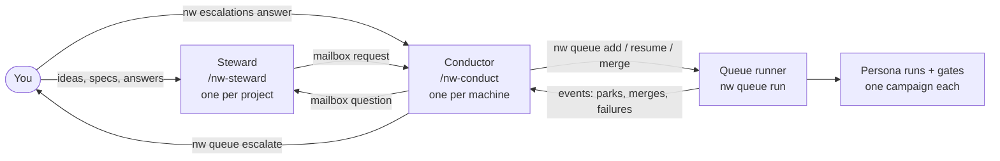

# Run the agentic loop (the normal workflow)

This page is the everyday path once nightwright is installed: register a project, start the
runner, open a **conductor** session and a **steward** per project, queue accepted specs, and
watch them get built and merged while you make product decisions. For the first-time
walkthrough with a check after each step, see [Bootstrap from zero](bootstrap.md). For park
reasons and recovery, see [Operating the loop](../loop/operate.md).

## Who talks to whom



## 0 · Install

Follow [Bootstrap from zero, steps 1 and 2](bootstrap.md#1-install): clone
`https://github.com/brunosmmm/nightwright.git`, `uv sync`, `uv tool install --editable .`, `nw skills install`, and a `config.yaml` with `timezone:` and
`agentic.conductor.prices`. `nw doctor --fix-hints` checks the install.

## 1 · Register the project

```bash
nw projects add Acme --repo ~/src/acme          # dry run: shows the plan
nw projects add Acme --repo ~/src/acme --yes    # writes outbox_targets.Acme to config.yaml
nw projects                                     # Acme listed with its repo path
```

nightwright's own checkout is the built-in project `Meta-Tools` and needs no registration.

## 2 · Describe it for the loop

```bash
nw projects init Acme          # prints a starter .nw/project.yaml (dry run)
nw projects init Acme --yes    # writes <repo>/.nw/project.yaml
nw projects config Acme        # the resolved file, defaults filled in
```

Edit the file and commit it to the project's main branch. The two parts that matter most:

- `gates`: the commands that prove a change works (tests, lint), each with `required` and
  `timeout_s`. They run in the campaign worktree, all of them, every time.
- `merge.policy`: `merge` (fast-forward into `merge.base`), `pr` or `draft-pr`.

Optional: profiles for this project in `<repo>/.nw/profiles/*.yaml`. Check them with
`nw profiles list` and `nw profiles show NAME --project Acme`.

## 3 · Ideas, then specs

```bash
nw idea capture "CSV export for the weekly report" --project Acme
nw next                                   # what each open idea needs next
```

Explore an idea until someone with no context could build it: `nw idea summary`,
`nw idea questions`, `nw idea log`, or `/nw-explore IDEA-NNN` in an agent session. Then
either:

- **write the spec yourself or with an agent**: `nw spec new --from-idea IDEA-NNN`, fill it
  in (or `/nw-new-work IDEA-NNN`), set `status: accepted`, commit, and run
  `nw spec review <ID>` once; or
- **queue the idea itself**: its campaign starts in `SPEC_WRITING`, where the `spec_writer`
  persona writes the spec and the `spec_reviewer` reviews it before implementation.

See [Write a spec the loop can build](../ideas/spec.md).

## 4 · Start the runner

```bash
nw queue run --detach      # background runner; one per machine, a lease stops a second
nw queue stop --yes        # later: stop it (a dry run without --yes)
nw queue restart --yes     # restart it with the same command; parks/resumes in-flight steps
```

You can skip this: the conductor starts the runner if none holds the lease. A merge that
changes nightwright's own code makes the runner re-execute itself, so upgrades need no restart.
A runner started with `--no-reexec` (or one stuck in a long drain) keeps the old code:
`nw queue watch` then shows `runner code stale`, and `nw queue restart` (dry run first) swaps it.

## 5 · Launch the conductor, then a steward per project

Use one Claude Code session for the conductor and one per project for stewards:

```bash
nw queue conductor-launch          # session 1: runs /nw-orient, then /nw-conduct
nw queue steward-launch Acme       # session 2, opened in Acme's repo: /nw-steward
nw queue steward-launch Acme --dry-run   # print the plan first (also on conductor-launch)
```

Typing `/nw-orient` then `/nw-conduct` (or `/nw-steward`) in an existing session also works;
the launch commands add a pinned model, forced context limits and a registered session id.
Both refuse to start until the session model has a price in `config.yaml`
(`agentic.conductor.prices`, keyed by model prefix, e.g. `claude-: {input: 3, output: 15}`).
`--resume` restarts the newest launched session.

**What the conductor watches.** It arms a Monitor on `nw queue events --follow --for conductor`
and is woken by every park, merge, failed run, stuck or dead runner and steward mail. It
resolves each from a decision table and escalates to you only when the table says so. It never
implements anything. `nw queue conduct-status` is its one-call situation report.

**What a steward watches.** It follows its project's mailbox
(`nw mailbox follow --to steward:Acme`), answers the conductor's questions about the project's
campaigns, and relays your queue requests to the conductor.

## 6 · Queue work through the steward

In the steward session, ask in plain words: "queue the CSV export spec", "bump SPEC-0007 to
priority 1", "merge branch my-fix". The steward does not run queue writes itself. It sends a
request to the conductor over the mailbox, for example:

```bash
nw mailbox send --to conductor --kind request "queue SPEC-0007 priority 2"
```

The conductor acts (`nw queue add … --yes`, `nw queue prioritize`, `nw queue merge`) and
answers; the steward reports back. You can also run `nw queue add SPEC-0007 --yes` yourself
(a dry run without `--yes`; the spec must be `accepted` and reviewed). Useful flags: `--priority 1..5`,
`--profile thorough`, `--epic SPEC-NNNN` for an epic's children, and `IDEA-NNN` to let the loop write the spec.

## 7 · Watch

```bash
nw queue watch             # live dashboard: runner, active campaigns, backlog, delivered
nw queue list              # what is in flight, in which state, at what cost
nw queue backlog           # queued items in admission order, and what each waits on
nw campaign show CAMPAIGN  # state, counters, cost, last events
nw campaign log CAMPAIGN --tail 20   # the campaign's ledger
nw queue events --tail 20 --text     # recent parks, merges, failures
nw queue conduct-status    # the conductor's situation report: lease, slots, parks, mail
nw queue decisions         # the conductor's decision log
nw escalations list        # questions waiting for you
nw mailbox list --to conductor --unanswered   # requests the conductor has not answered
nw tui --tab queue         # the same in the desk (also --tab events, --tab mailbox)
```

## Who decides what

| Agents decide (conductor, steward, personas) | You decide |
|---|---|
| Resuming, retrying or abandoning parked campaigns from the decision table | What gets built: scope, priorities between features, product direction |
| Clearing blockers: dead runner, rebase conflicts, flaky gates, cost-cap raises within 2x | Open escalations: `nw escalations list`, then `nw escalations show ID` |
| Judgment calls inside a spec: defaults, thresholds, option names, small scope additions | Answering them: `nw escalations answer ID --choose N --yes` (or `--text`, or `--waive` / `--attest` with `--reason`) |
| Implementation, gate triage, review and merge of accepted specs | Anything that touches your own checkout |

An escalation parks its campaign as `human_decision`. Your answer wakes the conductor, which
applies it. You can answer in the steward session too; the steward records it with
`nw escalations answer … --by steward:Acme`. Never edit the main checkout while the loop runs:
work on a branch in its own worktree and ask the conductor to merge it.

## Parks, resumes and merges

A campaign that needs a decision **parks** with a reason (`nw campaign show CAMPAIGN`). The
conductor resumes, retries or abandons most parks itself. If you act, queue writes are dry
runs until `--yes`:

```bash
nw queue resume CAMPAIGN --note "retry the flaky gate" --yes
nw queue resume CAMPAIGN --raise-cap 15 --note "large but legitimate" --yes
nw queue abandon CAMPAIGN --yes
nw queue merge my-branch --yes     # hand-made branch: rebase + re-gate + ff-merge
```

## When something is stuck

| Symptom | Look at | Fix |
|---|---|---|
| Nothing is progressing | `nw queue watch`, `nw queue conduct-status` | No runner: `nw queue run --detach` |
| Campaign parked | `nw campaign show CAMPAIGN` (reason) | See [When something parks](../loop/operate.md#when-something-parks); `nw queue resume` |
| Waiting on you | `nw escalations list`, then `nw escalations show ESC-NNNN` | `nw escalations answer ESC-NNNN --choose N --yes` |
| Conductor silent | `nw queue conduct-status`; `nw queue followers` | Re-open it: `nw queue conductor-launch --resume` |
| Steward silent, mail unanswered | `nw mailbox list --to steward:Acme --unanswered` | `nw queue steward-launch Acme --resume` |
| A run looks hung | `nw campaign tail CAMPAIGN -f` | The conductor's watchdog handles it; or `nw queue resume` |
| Runner crashed | `nw queue runner-log` | `nw queue run --detach`; running persona runs are adopted |
| Launch refuses to start | The error text | Add `agentic.conductor.prices` for the model |

## Later: remote workers (optional)

Gates and persona runs can be moved to other machines. `nw workers` is the registry on the
coordinator; `nw worker` runs on the worker host itself.

```bash
nw workers bootstrap box --ssh nw@box --install-key   # install nw on the worker and register it
nw workers add box --ssh me@box --slots 2             # or register one you set up by hand
nw workers list                                       # name, slots, enabled, cooldown, held
nw workers check                                      # probe over SSH
nw workers drain box                                  # no new gates; disabled once idle
```

Queue dispatch to workers is still being built
([SPEC-0310](https://github.com/brunosmmm/nightwright/blob/main/docs/specs/0310-remote-workers-run-gates-persona-runs-and.md)).
