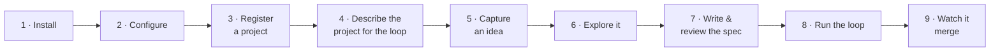

# Bootstrap from zero

This guide takes you from nothing to a spec built and merged by the agentic loop. Each step
ends with a **check**, so you know it worked before you move on. Allow about an hour the
first time.



## 1 · Install

```bash
git clone <this repo> wt && cd wt
uv sync                                 # creates .venv
uv tool install --editable '.[tui]'     # puts `wt` on your PATH, editable
wt skills install                       # installs /wt-* skills for Claude Code / Cursor
```

!!! check "Check"
    `wt --help` lists `idea`, `spec`, `queue`, `campaign` and `mailbox`. (A different tool on
    PyPI is also called `wt`. If its help talks about static sites, you have the wrong one.)

Install **editable**. The skills, the internal specs, and the agentic runner all run from
this checkout, and a `git pull` (or a merge by the loop) takes effect without reinstalling.

## 2 · Configure

wt keeps its config and data outside the repo (XDG):

| Path | Holds |
|---|---|
| `~/.config/wt/config.yaml` | where your org files live, timezone, outbound projects |
| `~/.local/share/wt/` | the data dir: campaigns, ledgers, events, mailbox, backups |
| your org dir (e.g. `~/org/`) | `ideas.org`: your ideas, as plain text you own |

```yaml
# ~/.config/wt/config.yaml (minimal)
org_files: [~/org]
org_ideas_file: ~/org/ideas.org
timezone: Europe/Lisbon
```

!!! check "Check"
    `wt idea "hello wt"` prints `✓ IDEA-001 …`, and `wt ideas` lists it.

## 3 · Register a project

Ideas and campaigns belong to a **project**, a repository the loop works on. wt's own repo
is the built-in project `Meta-Tools`. Register others by path:

```bash
wt projects add Acme --repo ~/src/acme --yes
wt projects                      # every project: topics, outbound, repo
```

!!! check "Check"
    `wt projects` shows `Acme`, with its repo path.

## 4 · Describe the project for the loop

The loop needs to know how to test and merge your code. That lives **in the repo**, in
`.wt/project.yaml`:

```bash
wt projects init Acme            # prints a starter (dry run)
wt projects init Acme --yes      # writes <repo>/.wt/project.yaml
```

```yaml
# <repo>/.wt/project.yaml
schema: wt.project.v1
project: Acme
base: main
gates:                     # run in the campaign's worktree; required ones must pass
  - name: tests
    cmd: uv run pytest -q
    timeout_s: 1200
    required: true
  - name: lint
    cmd: ruff check .
    required: false
merge:
  policy: merge            # merge | pr | draft-pr
worktrees:
  setup: [uv sync]         # run once in each new worktree
```

Commit this file. It's part of the project, and campaigns read it from main.

!!! check "Check"
    `wt projects config Acme` prints the resolved file with the defaults filled in, and no
    errors.

## 5 · Capture an idea

```bash
wt idea capture "CSV export for the weekly report" --project Acme --kind improvement
```

!!! check "Check"
    `wt next` shows it with a suggested next command.

See [Capture ideas](../ideas/capture.md) for the details.

## 6 · Explore it

Write down what you learn until the idea could be built by someone with no context:

```bash
wt idea summary IDEA-002 --set "Weekly report has no machine-readable export. Add
  'wt report --week --csv': one row per project+topic, hours as decimals. Out of scope:
  XLSX, scheduling."
wt idea questions IDEA-002 --add "Include zero-hour topics?"
wt idea log IDEA-002 --note "report.py builds rows in week_rows(); reuse it"
wt idea questions IDEA-002 --resolve 1        # once decided (record the answer in Summary)
```

Or, in an agent session: `/wt-explore IDEA-002`.

!!! check "Check"
    Your answer to "is it ready?" on [Explore](../ideas/explore.md#is-it-ready) is yes.

## 7 · Write and review the spec

```bash
wt spec new --from-idea IDEA-002      # scaffold docs/specs/NNNN-….md in the project repo
```

Then fill in the Decision, Design, Acceptance criteria and Test plan, or let an agent do it
with `/wt-new-work IDEA-002`, and set `status: accepted`. Commit it to main. Then:

```bash
wt spec review SPEC-0001              # approve | revise | split, with findings
```

Fix findings until it approves. See
[Write a spec the loop can build](../ideas/spec.md).

!!! check "Check"
    `wt spec review SPEC-0001` says `approve`.

## 8 · Run the loop

```bash
wt queue add SPEC-0001                # dry run: shows the plan
wt queue add SPEC-0001 --yes          # queue it
```

Then, in Claude Code, start the conductor: `/wt-conduct`. It starts the runner
(`wt queue run`) if it isn't running, and watches every event from then on.

!!! check "Check"
    `wt queue list` shows the campaign, and within a minute it moves from QUEUED to OPENING
    to IMPLEMENTING.

## 9 · Watch it merge

```bash
wt queue watch                        # live dashboard
wt campaign log SPEC-0001-… --tail 20 # the story so far
```

You'll see it implement, run your gates, get reviewed, rebase onto main, re-run the gates
and merge. If it parks, the reason tells you why. See
[when something parks](../loop/operate.md#when-something-parks).

!!! check "Check"
    The campaign ends `MERGED`, and `git log` on main shows the implementer's commits.

## Where next

- **Make your ideas better inputs:** [Ideas to specs](../ideas/index.md).
- **Understand the machine you just ran:** [How the agentic loop works](../loop/index.md).
- **Track the hours around the work:** [Track time](track-time.md).
