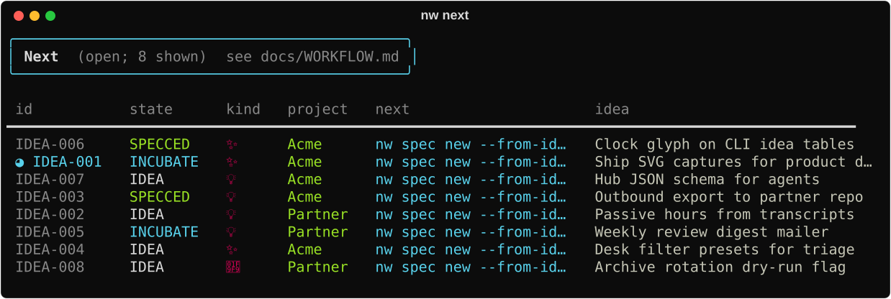
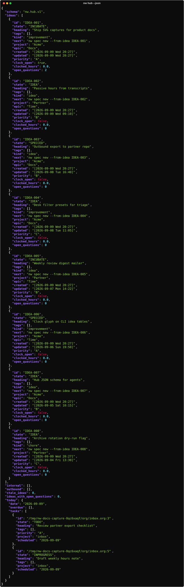
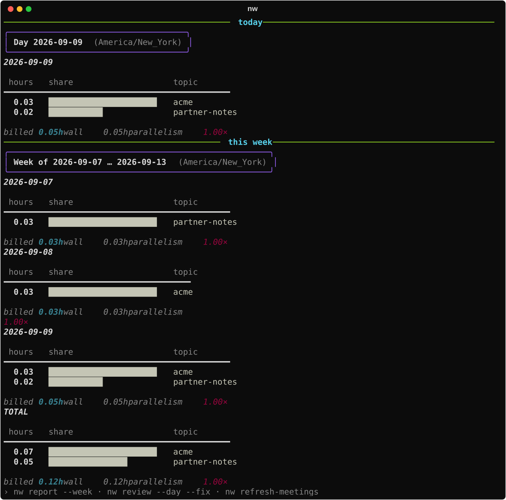
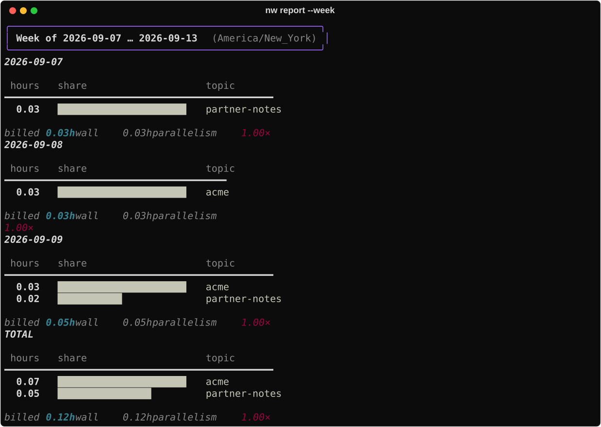

# Getting started

Install nightwright from **this** checkout (or a clone of it). PyPI’s package named `nw` is a
different tool — if `nw --help` talks about static sites (`init` / `build`), you have
the wrong binary.

## Install

```bash
uv sync                       # .venv + base deps
uv run nw --help              # verify: idea, report, projects, …
uv tool install --editable .  # put nightwright on PATH
# optional desk UI:
uv tool install --editable '.[tui]'   # from this checkout — not `uv tool install 'nightwright[tui]'`
```

Install **editable**: `nw skills install`, internal specs and the Meta-Tools research root
all resolve from this checkout, and a `git pull` takes effect without reinstalling. For a
non-editable install, set `nw_checkout: /path/to/nightwright` in `config.yaml`; otherwise those
commands stop with a hint saying so.

Config and data live under XDG (`~/.config/nightwright/`, `~/.local/share/nightwright/`), not in the repo.

Optional completion:

```bash
nw completion install --shell fish   # or bash / zsh
```

## Pick a first path

### Path A — capture and ship a thought

```bash
nw idea "short thought"
nw ideas
nw next
```




How the file looks: [Org-mode storage](org-storage.md). Full mini-spec loop:
[Idea → ship](idea-to-ship.md) (accept → build → **verify**). Another repo:
[Outbound](outbound.md).

### Path B — agent / automation

```bash
nw skills install
nw ideas --json
nw hub --json
nw next --json
```



Install skills, then use `/nw-orient` (or the skill that matches your step) in Cursor/Claude.
Claim done with `/nw-verify`. Full catalog: [Agent surface](agent-surface.md).
Humans can stay on the CLI or open `nw tui` ([Desk](../capabilities/tui.md)).

### Path C — see your hours

```bash
nw                                     # today + this week
nw report --week
nw topics --unmapped
nw map <base-topic> bucket=Acme
```





Deeper loop: [Track time](track-time.md) and [Weekly ops](weekly-ops.md).

## Day one habit

Once install works, prefer the operating guides over one-off commands:

- [Idea → ship](idea-to-ship.md) / [Outbound](outbound.md) — governing spec → verify
- [Daily ops](daily-ops.md) — agenda → tasks → next/hub → light report
- [Weekly ops](weekly-ops.md) — map unknowns → review → snapshot → close loops

Architecture overview: [Workflow architecture](../concepts/workflows.md).
