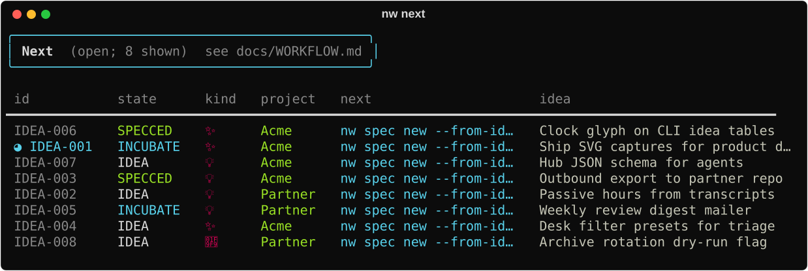

# Idea → ship

Turn a parked thought into finished work **inside this repo** (Meta-Tools / no outbound
project). For another codebase, use [Outbound](outbound.md).

## Pipeline

```
capture → explore → author accepted spec → generate tasks → build → verify
```

Full picture (roles and handoffs): [Workflow architecture](../concepts/workflows.md).
On-disk shape (Summary / questions / Log, rotation, archive): [Org-mode storage](org-storage.md).

After capture, triage looks like this:




| Step | Human CLI | Agent skill (optional) |
|------|-----------|------------------------|
| Capture | `nw idea "…"` | `/nw-capture`, `/nw-seed` |
| Enrich | `nw idea summary\|log\|questions` | `/nw-explore` |
| Related? | `nw ideas --query …` | `/nw-related` |
| Spec | `nw spec new --from-idea …` | `/nw-new-work` |
| Tasks | `nw spec generate SPEC-NNNN` | `/nw-generate` |
| Done? | `nw spec verify` / ledger | `/nw-verify` |

`nw next` (and `nw ideas --json`) recommend the next command per idea.

## Capture vs task

Ideas are **seeds**. Actionable one-offs are tasks:

```bash
nw idea "systemic gate design" --project Meta-Tools
nw add "fix the flaky CI gate" --project Meta-Tools
```

## Explore before promote

Do not promote an empty idea. Put durable notes on it first:

```bash
nw idea summary IDEA-00N --set "…"
nw idea log IDEA-00N --note "what we learned"
nw idea show IDEA-00N
nw idea mark-explored IDEA-00N   # when Summary is ready
```

States that matter: `IDEA` / `INCUBATE` → exploring; `SPECCED` → draft/accepted spec;
`PROMOTED` → org tasks exist. See [Concepts](../concepts/index.md).

## Accept, then generate

1. `nw spec new --from-idea IDEA-00N --internal` (or routing default for Meta-Tools).
2. Fill Decision / Design / Acceptance criteria / **Test plan**.
3. Set frontmatter `status: accepted`.
4. `python3 tools/spec_lint.py --write-ledger`
5. `nw spec generate SPEC-NNNN` → idea becomes **PROMOTED**.
6. Implement; clock with `nw idea clock-in` / `clock-out` while you work the slice.
7. Close the loop: tests + AC true + `status: done` + ledger — `/nw-verify` or
   `nw spec verify`.

If the design is wrong: `/nw-rework` (supersede), do not silently rewrite past `draft`.

## Triage rhythm

```bash
nw ideas
nw agenda
nw next
nw hub                 # union of ideas + specs + outbox
```

Optional desk: `nw tui` ([Desk](../capabilities/tui.md)).

Next: [Outbound](outbound.md) when `:PROJECT:` points at another repo.
