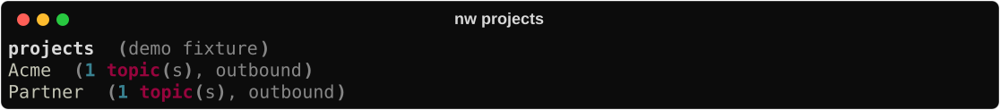
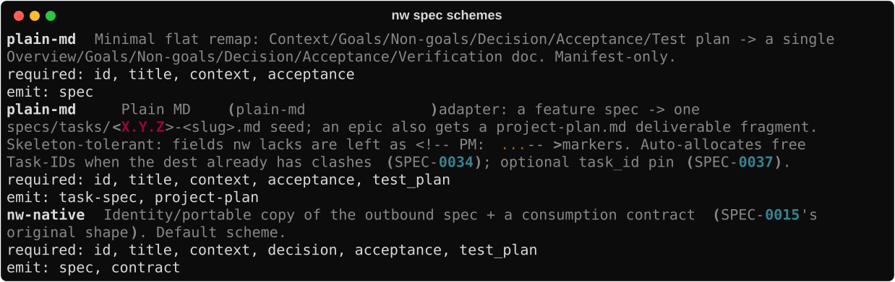

# Outbound

Ship work into **another** repo. The portable in that tree is what implementers edit;
nightwright’s outbox keeps a draft + the idea’s lifecycle. Closing the loop is **required**, not
optional.


## 1. Register the project

```bash
nw projects list --json
nw projects add Acme --repo ~/work/acme          # dry-run plan
nw projects add Acme --repo ~/work/acme --yes    # write outbox_targets
```



`repo_path` is both the **export destination** and the explore **research root**. Stubs
without a repo stay non-outbound until you add one.

To **rename the bucket** (config key + `<data_dir>/outbox/OLD` + idea `:PROJECT:` / Ext
headlines), use `nw projects rename OLD NEW` (dry-run) then `--yes`. That is different from
`projects add` retargeting the same key’s `repo_path`. In v1, outbound ids and filenames
stay as minted (e.g. `DEMO-0001` under the new folder); future mints use the new
bucket’s code. Target-repo portable rewrite / id rekey is not part of rename.

## 2. Capture with `:PROJECT:`

```bash
nw idea "…" --project Acme
# explore Summary / questions / Log as usual
nw spec new --from-idea IDEA-00N     # → data_dir/outbox/Acme/ACME-NNNN.md
```

Force an internal SPEC in this nightwright checkout instead: `--internal`.

## 3. Accept, then export (never generate)

Do **not** `nw spec generate` on outbound portables — that path is for internal SPECs.

```bash
# edit outbox portable → status: accepted
nw spec schemes                      # nw-native (default), plain-md
nw spec export ACME-NNNN             # scheme from outbox_targets or --scheme
# idea → EXPORTED; file lands in target docs/specs/
```



Unless the project sets `scheme:` (or you pass `--scheme`), export uses **`nw-native`**:
the lightweight governing portable (AC + Test plan) plus a consumption contract. That is
nightwright’s default outbound workflow — it tries to **enforce verification** before `done`, not
merely file-drop text. Details: [Default portable (`nw-native`)](../concepts/portable-default.md).

## 4. Implement in the target repo

In the foreign checkout: drive AC + Test plan on the portable (skill `/nw-implement-spec`
if skills are installed there). Prefer the portable’s status/`done` as source of truth.
Close with `/nw-verify` (or the same checklist by hand) before marking the portable `done`.

## 5. Required close-the-loop

Leaving the idea on `EXPORTED` after the portable is `done` is **debt**.

```bash
nw spec pull-status ACME-NNNN        # mirror portable status → outbox + idea
nw spec sweep                        # bulk pull-status/pull-clock for pending exports
# when portable is done → idea must become SHIPPED
nw idea show IDEA-00N                # confirm SHIPPED
```

Stuck on `EXPORTED` while the portable is already `done` → run `pull-status` (or `sweep`),
then fix any reconcile complaints (`nw spec reconcile`). Do not archive the idea as
`RESEARCHED` to hide outbound debt.

Optional after ship:

```bash
nw spec fit-log ACME-NNNN --note "…"
```

## Schemes (short)

| Scheme | Role |
|--------|------|
| `nw-native` | **Default.** Identity portable + consumption contract; requires Decision, AC, Test plan — lightweight verify-before-done workflow |
| `plain-md` | Optional flat remap for simple foreign layouts (weaker required fields) |

`nw spec schemes` lists required fields and emit artifacts. Concept deep-dive:
[Default portable (`nw-native`)](../concepts/portable-default.md).

## Related

- Fan-out epics: [Multi-project](multi-project.md) (`seed-children`)
- DoD matrix: [Lifecycle](../concepts/lifecycle.md)
- Weekly hygiene: [Weekly ops](weekly-ops.md)
- Capability: [Projects](../capabilities/projects.md)
