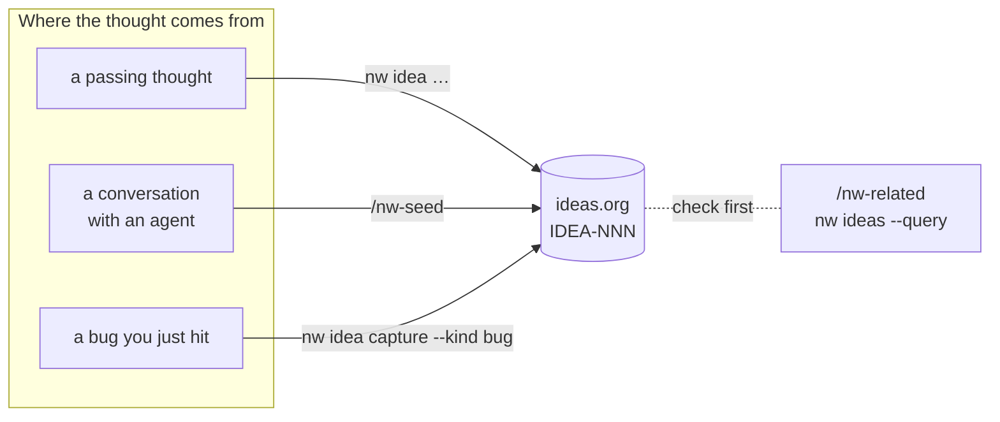

# Capture ideas

Capturing should cost seconds, so that nothing worth keeping gets lost and nothing breaks
your flow. Shape comes later, when you explore.



## The one-liner

```bash
nw idea "Weekly digest should group by project"
```

That's all you need. The idea gets the next free `IDEA-NNN` id and state `IDEA`, plus
`:CREATED:` / `:UPDATED:` stamps.

## Adding just enough shape

Add any of these at capture time, or later. They are what make an idea findable and
routable:

```bash
nw idea capture "Queue watch should show review rounds" \
    --project Meta-Tools \
    --epic SPEC-NNNN \
    --kind improvement
```

| Field | Why it matters |
|---|---|
| `--project` | Which project (repo) the work belongs to. It routes the spec to the right place, and the right queue |
| `--epic` | The umbrella spec this belongs to. Its spec becomes a child of that epic |
| `--kind` | `idea`, `bug`, `improvement` or `chore`, for triage and filtering |
| priority | `nw idea priority IDEA-NNN --set A` (A/B/C) |
| tags | `nw idea tags IDEA-NNN --set ui,perf` |

## From a conversation

When a chat with an agent has already shaped a thought, don't retype it. `/nw-seed`
distills the conversation into an idea with a title, an optional Summary and a Log entry,
so the context survives the session.

## Check before you capture

Ideas are global and long-lived, so the same thought often already exists, sometimes as a
closed idea with a lesson attached:

```bash
nw ideas --query "review rounds"     # open and closed ideas, ranked
```

In an agent session, `/nw-related` does this search and tells you whether to capture a new
idea, add to an existing one, or reopen a closed one.

## Seeing what you have

```bash
nw ideas                   # open ideas
nw ideas --project Acme    # one project
nw next                    # every open idea with its next command
nw tui                     # the desk: browse, edit, change state
```


**Next:** [Explore until it's ready](explore.md).
