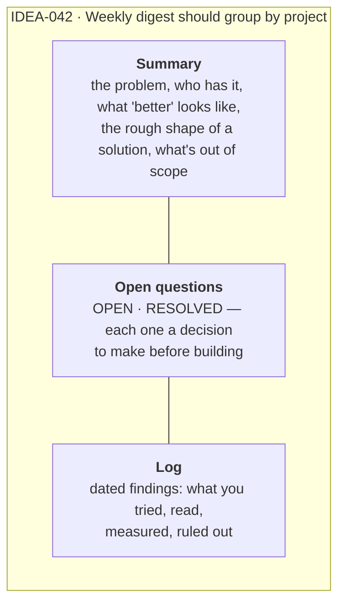
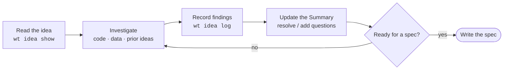

# Explore until it's ready

Exploring turns a one-liner into something another person, or an agent with no context,
could build from. You write durably on the idea itself as you learn, and only write a spec
once the idea is ready.

## What an explored idea looks like

Every idea has three sections. Exploring fills them in:



| Section | Command | Write here |
|---|---|---|
| **Summary** | `wt idea summary IDEA-042 --set "…"` | The current best understanding, rewritten as it improves. This is the gate for writing a spec |
| **Open questions** | `wt idea questions IDEA-042 --add "…"`, `--resolve 1` | Decisions still to be made. Resolve them by recording the answer in the Summary or the Log |
| **Log** | `wt idea log IDEA-042 --note "…"` | Dated, append-only findings: code you read, experiments, numbers, dead ends |

```bash
wt idea show IDEA-042      # read all three
wt idea mark-explored IDEA-042   # record that an exploration pass happened
```

## The exploration loop



In an agent session, `/wt-explore IDEA-042` runs this loop: it investigates, logs what it
found, and sharpens the Summary and questions. It never promotes the idea; that's a
deliberate, separate step.

## Is it ready?

Write the spec only when you can tick these:

- [ ] **The problem is stated**, with who has it and why it matters, in the Summary.
- [ ] **"Done" is concrete enough to test.** You could list 3–8 checkable acceptance
      criteria.
- [ ] **No blocking open questions**: everything that changes the design is resolved.
- [ ] **The scope fits one campaign.** If it's several independent pieces, it's an epic
      (see [Write a spec](spec.md#one-campaign-or-an-epic)).
- [ ] **Out of scope is written down**, so the loop won't build what you didn't ask for.
- [ ] **Related work is linked**: other ideas, specs, files in the code.

If exploring shows the idea isn't worth building, close it with a reason, so the lesson
stays findable:

```bash
wt idea close IDEA-042 --as researched --reason "solved by existing --by-project flag"
wt idea close IDEA-043 --as drop --reason "duplicate" --folded-into IDEA-012
```

**Next:** [Write a spec the loop can build](spec.md).
