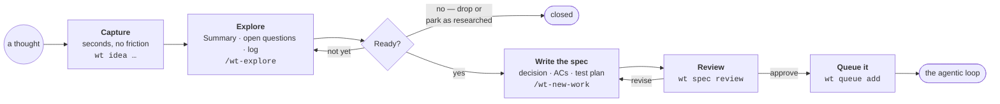
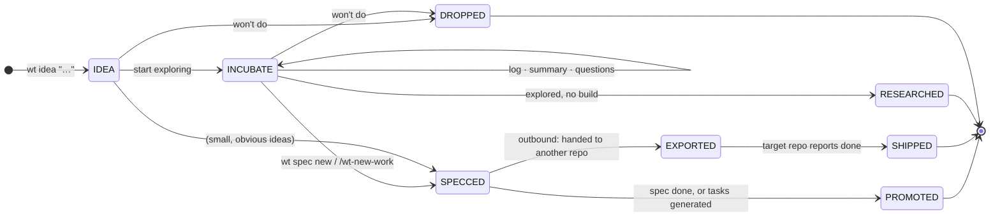
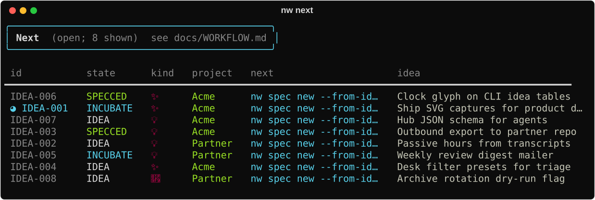

# Ideas to specs

The agentic loop builds exactly what a spec asks for, no more and no less. The quality of
what comes out is set long before the loop starts: by how well the idea was understood, and
how clearly the spec says what "done" means. This section is about that half of the work.

| Step | You end up with | Read |
|---|---|---|
| **Capture** | A one-line idea with an id, a project, and maybe an epic | [Capture ideas](capture.md) |
| **Explore** | A Summary someone else could act on, resolved questions, a log of findings | [Explore until it's ready](explore.md) |
| **Write the spec** | A spec with a decision, objective acceptance criteria and a test plan | [Write a spec the loop can build](spec.md) |
| **Review and queue** | An approved spec in the queue | [Write a spec…](spec.md#review-then-queue) |

## The life of an idea

Ideas live in an org file (plain text you own), each with a stable `IDEA-NNN` id. Their
state tells you, and `wt next`, what to do next.

`wt next` reads these states and prints the next command for every open idea. It's the
quickest way to see what's waiting on you.

## Why the ideas half matters for the loop

- **The loop can't fix a vague goal.** If the acceptance criteria are fuzzy, the reviewer
  can't check them, the implementer guesses, and the loop either "passes" the wrong thing or
  never converges.
- **Exploration is cheap; loops are not.** A few minutes resolving an open question in the
  idea saves a failed campaign.
- **One idea, one buildable slice.** Ideas that turn out to be several pieces of work become
  an *epic* with child specs, each small enough for one campaign.

!!! info "In progress: put the idea itself in the queue"
    Specs SPEC-0208–0217 add `wt queue add IDEA-NNN`. A campaign will then write the spec
    from your explored idea, review and revise it, accept it, and build it, all on one
    branch. Exploring the idea well becomes even more important, because it's the only
    input that campaign gets.
