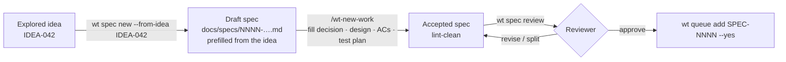
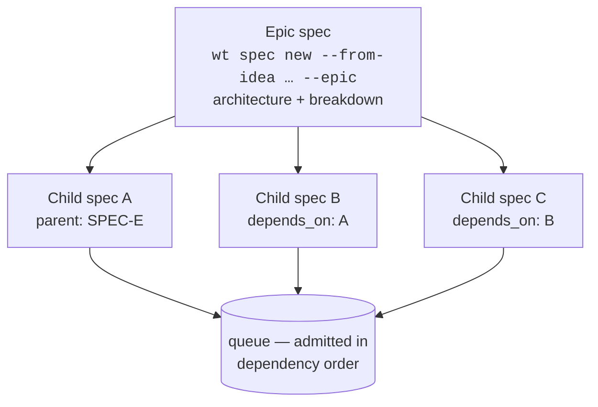

# Write a spec the loop can build

A spec is the contract between you and the loop. The implementer builds against it, the
reviewer checks against it, and the close step refuses to merge if it changed along the way.
A good spec is short, decided and checkable.

## From idea to spec



`wt spec new --from-idea` scaffolds the spec from the template, prefills Context from the
idea, links the two (the spec's `source_idea`, the idea's `:SPEC:`), and moves the idea to
SPECCED. `/wt-new-work` guides an agent through finishing it and getting it to `accepted`.

## Anatomy of a good spec


| Section | The loop uses it for | Make it good by |
|---|---|---|
| Goals / **Non-goals** | Knowing what *not* to build | Naming tempting extras explicitly |
| Decision | Picking one approach instead of exploring | Stating it as a decision, not a discussion |
| Design | Concrete targets: files, functions, shapes | Naming real code paths; specifying failure cases, not just the happy path |
| **Acceptance criteria** | The implementer's checklist and the reviewer's yardstick | Each one checkable by a test or a command; no "should be nice" |
| **Test plan** | What the gates must prove | One test, or more, per AC; named test files |

### Acceptance criteria that work (examples)

| Weak | Strong |
|---|---|
| "The dashboard shows reviews nicely." | "`wt queue list` shows `SPEC_REVIEW r2` for a campaign in its second review round." |
| "Handle errors." | "An empty title exits non-zero with the message `empty title`, and writes nothing." |
| "Fast enough." | "`wt ideas` on 2,000 ideas returns in under 1 s (test with the fixture in `tests/…`)." |

## One campaign, or an epic?

A spec should be one campaign's worth of work: roughly up to ten acceptance criteria, in one
subsystem. If it's bigger, the reviewer will answer `split`, and it's better to split
deliberately:



`depends_on` matters: the queue admits a spec only once everything it depends on is done on
main. `wt spec seed-children` turns an epic's breakdown into ideas, and `/wt-rework` extends
an incomplete epic or supersedes a design that turned out wrong.

## Review, then queue

```bash
wt spec review SPEC-0042        # read-only reviewer persona: approve | revise | split
wt queue add SPEC-0042 --yes    # needs an approving review of the current text
```

The reviewer checks four things:
- consistency: every AC follows from the design, and every design promise has an AC;
- testability;
- fit to the source idea;
- size.

It returns findings by severity: must_fix, major, minor and nit. Fix the must_fix and major
ones and review again. If the same spec keeps coming back with new findings round after
round, stop and narrow or rework it (see
[Convergence](../loop/convergence.md#persistent-divergence-means-rework)).

## Changing your mind

Never silently rewrite an accepted spec. Write a new one that `supersedes` it, and mark the
old one `superseded`. `/wt-rework` does this. The ledger of specs then stays a faithful
history of what was decided and why.

**Next:** [How the agentic loop works](../loop/index.md).
