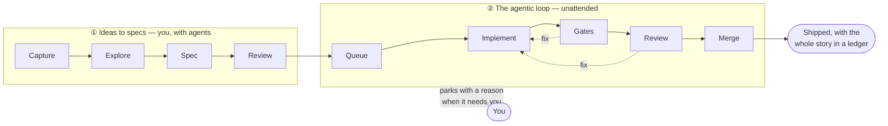
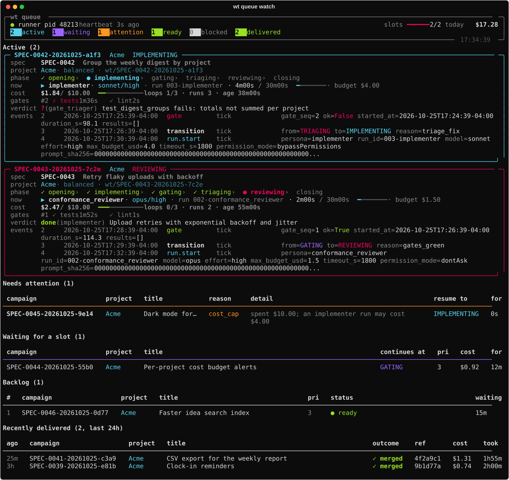
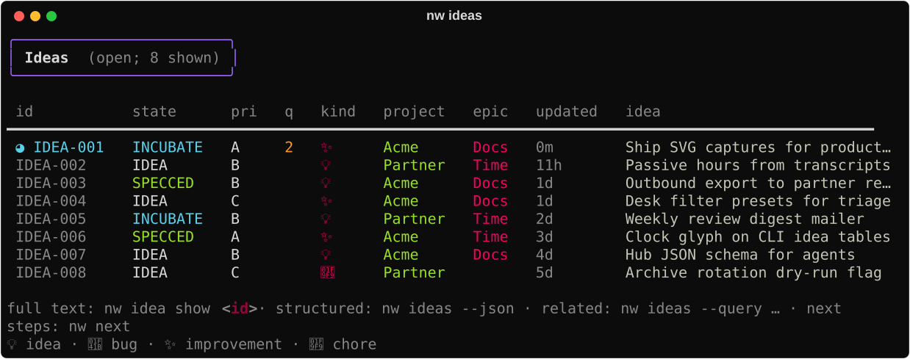
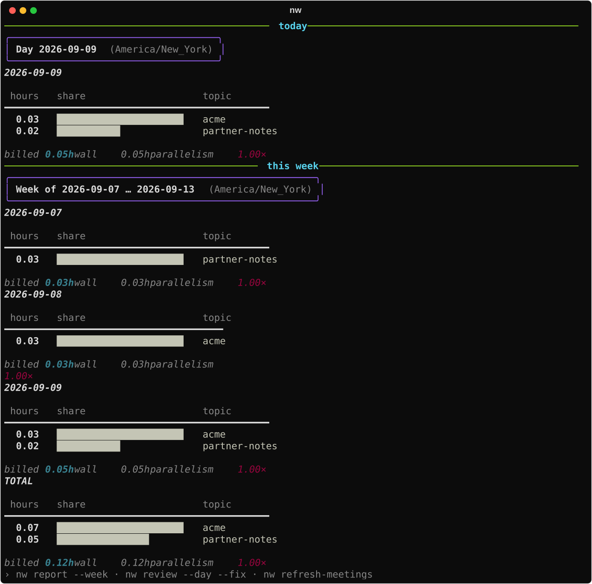

# nightwright

**nightwright turns ideas into shipped code.** You capture ideas and explore them until they're
clear. You then write them up as short specs with testable acceptance criteria, and hand
those specs to an **agentic loop** that implements, tests, reviews and merges them, coming
back to you only when it needs a decision. Along the way, nightwright sees the passive time you spend
on each topic.

- :material-lightbulb-on-outline: **[Ideas to specs](ideas/index.md)**

    ---

    Capture a thought in seconds, explore it until it's fully fledged, and write a spec
    that says exactly what "done" means: decision, acceptance criteria, test plan.

- :material-robot-outline: **[The agentic loop](loop/index.md)**

    ---

    A small, deterministic machine around fresh persona runs. It implements, runs your
    tests, reviews against the spec and merges, with bounded loops, cost caps and a clear
    escalation ladder.

- :material-rocket-launch-outline: **[Bootstrap from zero](guides/bootstrap.md)**

    ---

    Nine steps with a check after each: install, configure, register a project, and watch
    your first spec get built and merged.

- :material-clock-outline: **[Track time](guides/track-time.md)**

    ---

    Passive time per topic from your Claude Code / Cursor transcripts and meetings. No
    timer for that signal.

## What you get

| | |
|---|---|
| **Ideas you own** | Plain-text org files with stable ids (`IDEA-042`), a lifecycle, and next-step hints (`nw next`) |
| **Specs that mean something** | Short governing specs: acceptance criteria and a test plan, reviewed before build, verified after (`nw spec verify`, `/nw-verify`) |
| **An unattended build loop** | Queue → implement → your gates → conformance review → rebase, re-gate, merge, with every step in a ledger |
| **Agents in the right places** | Headless personas for judgment, plain code for everything else, and a conductor session that handles the alerts |
| **Passive time** | Hours per topic and project, with no timer. `nw idea clock-in` / `clock-out` adds supplemental wall-time when you want it ([Clock](capabilities/clock.md)) |

You meet nightwright as a command-line tool (`nw ideas`, `nw queue watch`, `nw report`), as the
interactive ideas **desk** (`nw tui`), and as agent skills (`/nw-explore`, `/nw-new-work`,
`/nw-conduct`, …).

=== "The loop at work"

    

=== "Your ideas"

    

=== "The desk"

    

=== "Your time"

    

## Find your way

| If you want to… | Go to |
|---|---|
| Set everything up, step by step | [Bootstrap from zero](guides/bootstrap.md) |
| Turn a vague idea into a buildable spec | [Ideas to specs](ideas/index.md) |
| Understand how the loop works and why | [How it works](loop/index.md) · [Principles](loop/principles.md) |
| Know what to do when a campaign parks | [Operating the loop](loop/operate.md#when-something-parks) |
| Build by hand, without the loop | [Idea → ship (by hand)](guides/idea-to-ship.md) |
| Hand work to another repo | [Outbound](guides/outbound.md) |
| See your hours | [Track time](guides/track-time.md) |
| Run a day or a week with nightwright | [Daily ops](guides/daily-ops.md) · [Weekly ops](guides/weekly-ops.md) |
| Look up a command | [Reference](reference/index.md) |
