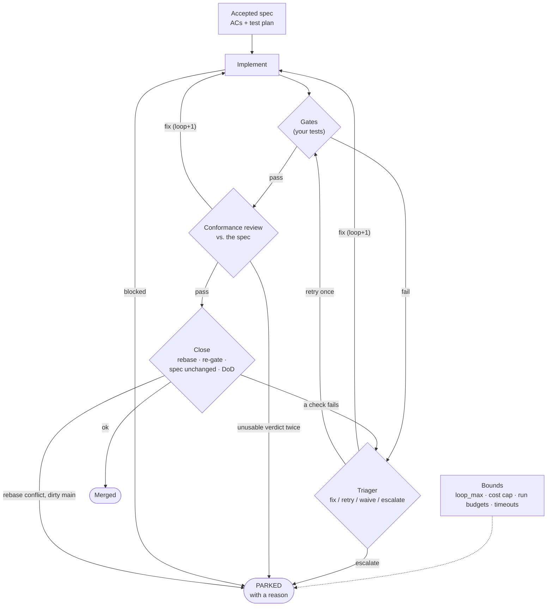
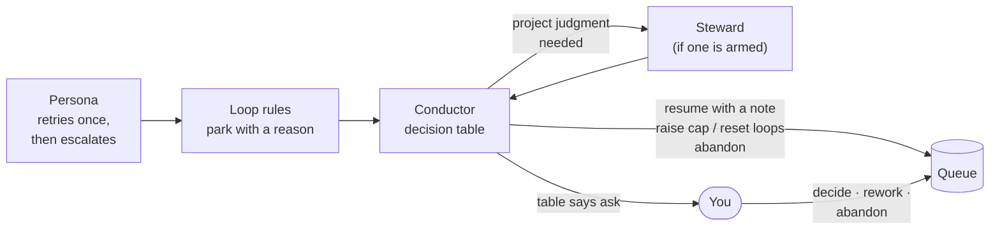

# Convergence and escalation

A loop that writes code, tests it and fixes it can fail in two ways: it never finishes, or it
finishes with the wrong thing. nightwright's answer is not one smart controller. It layers several
small mechanisms, each catching a different kind of trouble, and a clear ladder for what
happens when they all run out.

## The layers

| Mechanism | Catches | How |
|---|---|---|
| **A good spec** | Building the wrong thing | Objective acceptance criteria and a test plan. Reviewed *before* it is queued (`nw spec review`) |
| **Gates** | Code that doesn't work | Your own test and lint commands, deterministic, in the worktree. Required gates must pass |
| **Gate triage** | Flaky tests; misleading failures | A triager persona reads the failure and picks **fix** (with a brief), **retry** once, **waive** (optional gates only) or **escalate** |
| **Conformance review** | Code that works but misses the spec | A read-only reviewer checks each AC against the change. Any must_fix sends it back |
| **Fresh context + briefs** | Runs drifting off course | Each retry starts clean, carrying only the findings to address |
| **Loop limit** | Endless fix → fail → fix | `loop_max` trips back to the implementer, then park `loop_exhausted` |
| **Cost cap & budgets** | Runaway spend | A campaign cap, plus a per-run budget for each persona. Hitting the cap parks `cost_cap` before the next run |
| **Spec-change guard** | "Passing" by weakening the spec | At close, the spec must match its accepted text, apart from ticked boxes and status |
| **Rebase + re-gate** | Breaking main | Code merges only after passing the gates again on top of current main |
| **Deterministic conflict resolver** | Spurious conflicts | Generated files such as `docs/LEDGER.md` are regenerated, not merged by hand |

## When a campaign doesn't converge

Each layer has an exit: a **park with a reason**. The reason names which mechanism gave up,
so the next decision can be specific:
- `loop_exhausted`: the fix loop hit its limit;
- `triage_escalated`: the triager couldn't judge a failure;
- `review_escalated`: the reviewer returned no usable verdict;
- `implementer_blocked`: the implementer says the spec can't be built as written;
- `cost_cap`: the money ran out;
- `rebase_conflict`: main moved under the campaign in a way it can't resolve.

The full list, with what to do for each, is in
[Operating the loop](operate.md#when-something-parks).

## The escalation ladder

1. **Inside a step:** a persona that returns an unusable verdict gets one retry. A flaky gate
   gets one re-run.
2. **The loop's own rules** park the campaign when a bound is hit, or when a persona
   escalates.
3. **The conductor** wakes on the `parked` event and applies its decision table: for
   example, resume a `rebase_conflict` at GATING, retry an `open_failed` once, or resume
   with a fix brief.
4. **A steward**, when one is armed for the project, answers project-judgment questions over
   the mailbox. A steward is optional; the ladder works without one.
5. **You** are asked only when the table says so, with the campaign, the reason and the
   evidence already gathered.

## Persistent divergence means rework

Sometimes a loop keeps "almost" working. Every round fixes the previous findings and
uncovers new ones, the scope creeps, and verdicts flip back and forth. That is rarely solved
by one more round. It usually means the **design itself is wrong**: too big, the wrong
shape, or built on a wrong assumption.

So **rework is a first-class outcome**. Instead of another round, the work is restarted from
its idea or its spec, with a brief that carries what was learned:
- the recurring findings, as constraints;
- the scope that turned out to be too much, cut.

For an accepted spec that means superseding it with a new one (`/nw-rework`), never quietly
editing the old one.

!!! note "Planned: divergence detectors ([IDEA-089](../ideas/index.md))"
    Today a human or the conductor notices divergence. Planned: nightwright computes signals per round
    from the ledger and the review store:
    - must_fix/major counts not falling;
    - a high share of *new* findings each round;
    - findings coming back after being fixed;
    - flip-flopping verdicts;
    - a growing spec or diff;
    - the same test failing again and again.

    When a threshold trips, it raises a `review_divergence` alert. A triager then picks
    continue, narrow, split, rework or escalate, before the conductor and finally you are
    asked.

## Keeping it simple

Each mechanism is a counter, a cap, a schema or a rule, and it's easy to see which one fired.
When you're tempted to add a special case to keep a loop going, ask whether the work should
be **narrowed** or **reworked** instead. That is usually the cheaper path to a good result.
