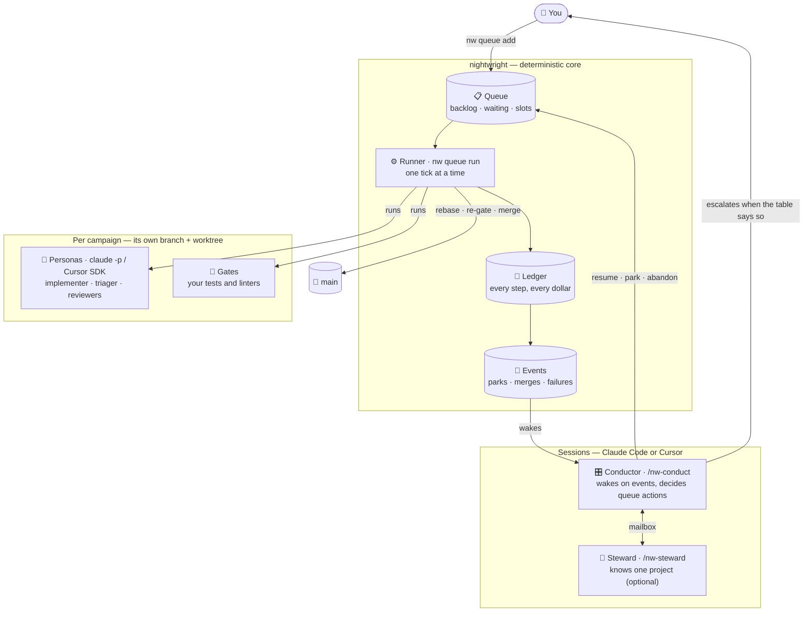
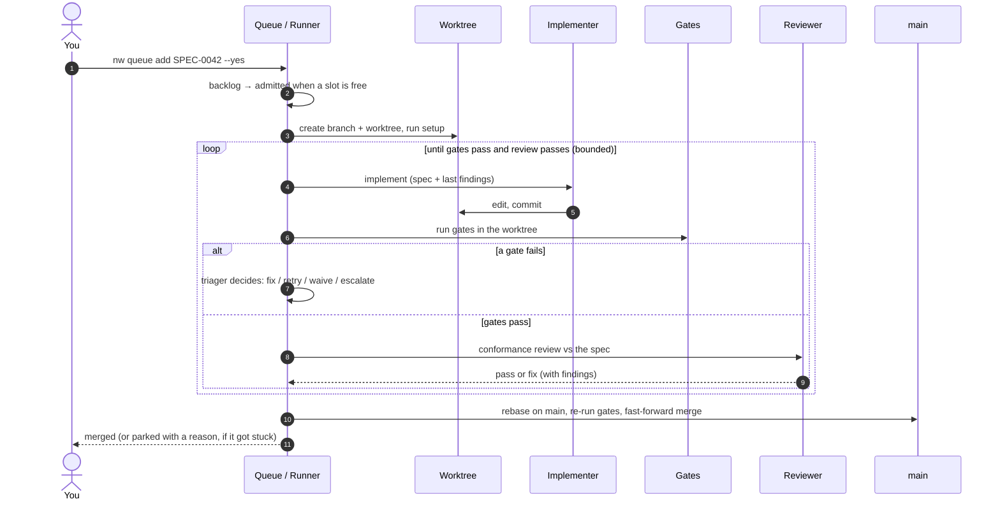
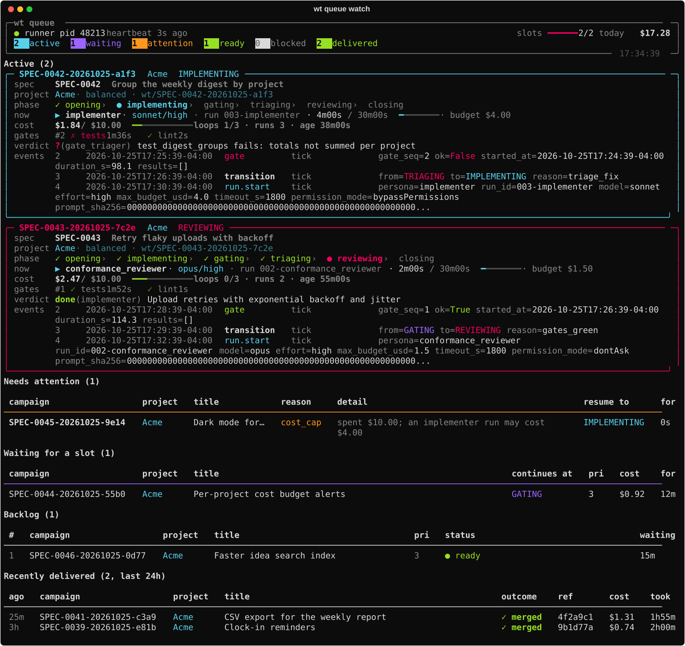

# How the agentic loop works

The agentic loop takes an **accepted spec** and turns it into **merged, tested code**
without anyone at the keyboard. You queue the work, and the loop opens a branch, implements,
tests, reviews, fixes and merges. It only comes back to you when it needs a decision.

It is built from a few plain parts. Each part does one job, and every step is written down.

## The big picture

| Part | What it is | What it does |
|---|---|---|
| **Queue** | Campaign state files under `<data_dir>/agentic/` | Holds the backlog (not started), what's waiting for a slot, what's active, what's parked |
| **Runner** | One `nw queue run` process holding a lease | Each *tick*: admit work into free slots, run the next step of every active campaign, record everything |
| **Campaign** | One spec's trip through the loop | Has its own branch and worktree, a state, counters, a cost, and an append-only ledger |
| **Personas** | Fresh headless `claude -p` or Cursor SDK runs | Do the judgment work: implement, triage a failing gate, review. Each run starts with fresh context and a budget. Default is Claude; Cursor is opt-in |
| **Gates** | Shell commands from `.nw/project.yaml` | Your tests and linters, run deterministically in the worktree. Gates are where code meets reality |
| **Event stream** | A projection of every ledger | Turns "campaign parked", "merged", "runner dead" into alerts |
| **Conductor** | A long-lived Claude Code or Cursor session | Wakes on events and decides from a fixed decision table. It never implements anything |
| **Steward** | A project session (optional) | Answers project questions the conductor asks over the mailbox |
| **You** | — | You're asked only when the conductor's table says so |

## One campaign, end to end

Everything in that diagram is written to the campaign's ledger as it happens: every state
transition, persona run, gate result, finding and dollar. `nw campaign log <id>` replays it,
and `nw queue watch` shows it live.

## Where to go next

- **[Principles](principles.md)** — why it's built this way, and what it will never do.
- **[The state machine](states.md)** — every state a campaign can be in, and every move
  between them.
- **[Convergence and escalation](convergence.md)** — how loops are kept short, and what
  happens when they aren't.
- **[Operating the loop](operate.md)** — starting it, watching it, and what to do when
  something parks.

New here? Start with **[Bootstrap from zero](../guides/bootstrap.md)**. To get good specs
into the loop, read **[Ideas to specs](../ideas/index.md)**.
