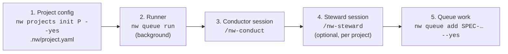

# Operating the loop

This page is the day-to-day manual: how to start the loop, how to watch it, and what to do
when a campaign stops and asks for you.

## Starting up



1. **Describe the project once.** `.nw/project.yaml` lives in the repo and says how to run
   your gates, how to merge (`merge`, `pr` or `draft-pr`) and how to set up a worktree.
   `nw projects init <Project>` prints a starter, `--yes` writes it, and `nw projects config`
   shows the result.
2. **Start the runner.** There is one `nw queue run` per machine; a lease stops a second one.
   The conductor starts it for you if it isn't running. It picks up merged changes to nightwright
   itself by re-executing between ticks, so you never have to restart it after an upgrade.
3. **Open a conductor session.** In Claude Code, run `/nw-conduct`. It watches the event
   stream and reacts to every park, merge, failure or stuck run using its decision table.
   It never writes code.
4. **Optionally, a steward per project.** In a session that knows the project, run
   `/nw-steward`. The conductor asks it project questions over the mailbox. Everything still
   works without one.
5. **Queue work.** `nw queue add SPEC-0042 --yes` (a dry run without `--yes`). The spec must
   be `accepted` and have an approving review (`nw spec review SPEC-0042`).

## Watching

```bash
nw queue watch            # live dashboard: runner, active panels, waiting, backlog, delivered
nw queue list             # compact table of what's in flight
nw campaign show C        # one campaign: state, counters, cost, last events
nw campaign log C --tail 20
nw campaign runs C        # every persona run: cost, exit, verdict
nw queue runner-log       # what the runner did, start/stop/crash records
nw queue followers        # who is watching: conductor, stewards, their lag
```

The dashboard shows, for each active campaign, its phase, what it's doing right now (for
example "implementer · sonnet/high · 4m12s / 30m"), its cost against its cap, the last gate
results and the last verdict. Below that come the started work waiting for a slot, the
backlog with what each item waits on, and what was recently delivered.

## When something parks

A park always carries a **reason**, a **detail**, and the **state it resumes to**. The
conductor handles most of them from its table; this is what each one means, and what you or
it would do.

| Reason | What happened | Usual next step |
|---|---|---|
| `cost_cap` | The next run would pass the campaign's dollar cap | Resume once with `--raise-cap` (up to 2× the profile cap) and a note. A second cost park → look at why it's expensive |
| `loop_exhausted` | The fix loop hit `loop_max` without passing | Read the last triage brief and review. Transient failures → `--reset-loops`; a wrong spec → rework the spec |
| `diverging` | The fix loop is not converging (a finding came back, or blocking counts and gate failures are not dropping) | A conductor sub-agent reads the `loop_divergence` evidence and picks: continue (`nw queue resume`), rework (`nw queue abandon`, then `/nw-rework` the spec) or escalate to the human |
| `triage_escalated` | The gate triager couldn't decide twice, or chose escalate | Read the gate log tail. Resume to GATING if it was flaky, with a note if it's a real decision |
| `implementer_blocked` | The implementer reported the spec can't be built as written | Read its blockers. Usually the spec needs a fix: rework it |
| `review_escalated` | The conformance reviewer produced no usable verdict twice | Re-run the review (resume to REVIEWING), or read the diff yourself |
| `spec_write_failed` | The spec writer's output was rejected twice (wrong file, bad front matter, missing section, placeholder, failing generated-file command), it answered `blocked`, or its idea's `:EPIC:` names no epic spec | Read the detail; resume with a `--note` to steer the writer (the idea snapshot is refreshed and the retry count reset), or abandon |
| `spec_review_exhausted` | The spec phase stopped (one review per campaign, SPEC-0230): the writer's revision did not change the spec (resumes to the writer), the reviewer failed twice or changed the worktree, the worktree had uncommitted tracked changes, or the accept commit failed (these resume to the review) | Read the detail. Resume (add a `--note` to steer the writer), or abandon |
| `spec_review_unavailable` | Legacy park (the spec review is now part of the campaign) | Resume: it goes to the spec review, or to the writer when you give a `--note` |
| `spec_writer_unavailable` | Legacy park of an idea campaign from before the spec writer shipped | Resume: it now runs the writer |
| `rebase_conflict` | Main moved and the branch no longer rebases cleanly | Resolve on the branch, or resume to GATING after main settles. Generated-file conflicts are resolved automatically |
| `base_moving` | Main changed while the close step was merging | Resume; it retries the close on the new main |
| `main_dirty` | Someone left uncommitted changes in the main checkout | Move that work to a branch, then resume. Never edit the main checkout while the loop runs |
| `main_not_on_base` | The main checkout isn't on the base branch | Switch it back, then resume |
| `gates_failed` | A merge request (`nw queue merge`) failed its re-gate; its branch is left rebased onto main | Tell the requester; once the branch is fixed, resume |
| `worktree_dirty` | A merge request's worktree has uncommitted or untracked changes (nothing is committed for the requester) | Commit or stash them, then resume |
| `human_decision` | The conductor escalated a decision to you (`nw queue escalate`): the detail starts with the `ESC-NNNN` id and the question | `nw escalations show ESC-NNNN`. If it resolves without you, `nw escalations withdraw` it and resume the campaign |
| `not_docs_only` | A `nw queue merge --docs-only` request changes a path outside `merge.docs_only_paths` (checked again after the rebase); no gate has covered it | A resume would park again: `nw queue abandon <id> --yes` (the worktree and branch are kept), then `nw queue merge <branch> --yes` without `--docs-only` |
| `regenerate_failed` | After the rebase, a `merge.regenerate` command failed, or it left undeclared files changed (SPEC-0255); nothing was merged and the worktree is back at HEAD | Read the detail, fix the command or the source it reads, then `nw queue resume <id>` (back to `CLOSING`) |
| `gate_timeout` | Gates timed out on three consecutive runs, two of them serialized re-gates (SPEC-0311); no fix loop was spent | Likely machine load or a `timeout_s` that is too low: raise it or wait for the load to drop, then `nw queue resume <id>` (re-gates alone, first) |
| `open_failed` | Creating the worktree or a step failed unexpectedly | Read the detail and retry once; if it fails again, investigate |
| `gh_failed` | Opening the PR (`pr` / `draft-pr` policy) failed | Check `gh auth`, then resume |
| `config_invalid` | `.nw/project.yaml` didn't load | Fix the config. The campaign resumes **by itself** once it loads |
| `human` | Someone ran `nw queue park` | Resume when you're ready |

```bash
nw queue resume C --note "the flaky test is test_x; retry" --yes   # back to its resume state
nw queue resume C --to GATING --yes                                # pick the state explicitly
nw queue resume C --raise-cap 15 --note "large but legitimate" --yes
nw queue resume C --reset-loops --yes                              # after transient failures
nw queue abandon C --yes                                           # give up; removes the worktree
nw queue gc                                                        # list leftover worktrees/merged branches of finished campaigns; --yes removes them (with their ignored files)
```

Every queue write (`add`, `resume`, `park`, `abandon`, `gc`, `prioritize`) is a dry run until you
add `--yes`. A resumed campaign goes straight back to work if a slot is free, or to **WAITING** (first in
line) if not.

## Costs and profiles

A **profile** sets how many slots run at once, how many fix loops are allowed, the timeout
per run, and each persona's model and budget. The builtin profiles are `balanced` (the
default), `frugal` and `thorough`. `nw queue add … --profile thorough` picks one per campaign.
Every run's cost is charged to its campaign and shown in `nw queue watch` and
`nw campaign runs`.

## Working outside the queue

Not everything has to go through the queue. To build something by hand:
1. Work on a **branch in its own worktree** (`git worktree add -b my-change ../nw-my-change
   main`). Never edit the main checkout in place, because it is the runner's code and the
   merge target.
2. Commit, run the tests, keep the spec truthful.
3. Ask the conductor to merge it: `nw mailbox send --to conductor --kind request "please
   merge branch my-change …"`. It holds the merge until no campaign is closing, so it never
   pulls main out from under one.

## The conductor and stewards

- **The conductor** (`/nw-conduct`) is woken by events and works through a fixed decision
  table. It does quick reads and writes itself, and sends anything slow (investigating a
  stuck run, reading a diff) to background helpers, so it never blocks. It sends a periodic
  digest of what's blocked, stuck or waiting on a decision.
- **A steward** (`/nw-steward`) is a session that knows one project. It answers the
  conductor's project questions and relays your requests for that project to the conductor.
  It never edits a campaign's worktree.
- **You** talk to either. Requests that change the queue end up with the conductor, so one
  place decides.
