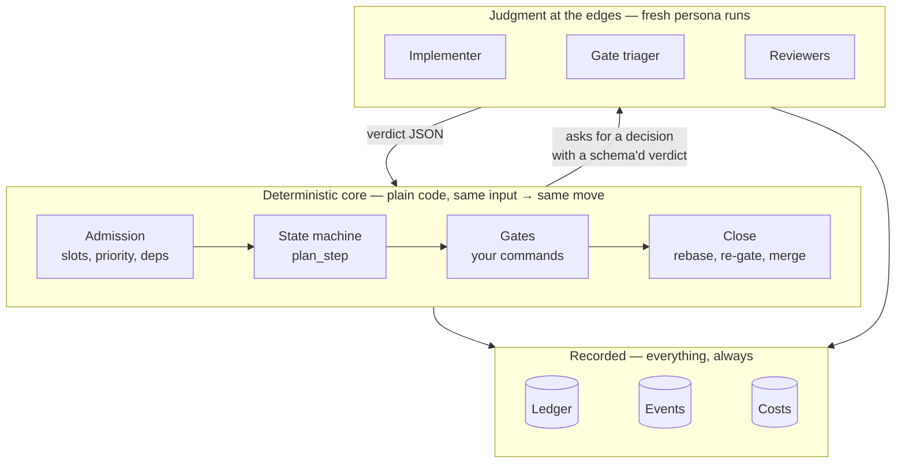

# Principles

The loop is small on purpose. A handful of principles keep it predictable, cheap to reason
about, and safe to leave running. When a design choice in nightwright looks odd, it's usually one of
these at work.

## 1. A deterministic core, judgment at the edges

The parts that must be predictable are **plain code**:
- what gets admitted;
- what the next step is;
- whether the tests passed;
- how the merge happens.

The parts that need judgment run as **persona runs**:
- writing code;
- deciding whether a failing test is a real bug or flakiness;
- checking a change against a spec.

A persona never moves the campaign itself. It returns a **verdict** in a fixed JSON schema,
and the deterministic code decides the transition from that verdict. So you can read the
rules for "what happens after a failed gate" in one function, and they don't depend on how
an LLM phrased its answer.

## 2. Fresh context for every run

Each persona run starts from scratch. It gets the spec, the worktree and a short brief (for
example "the last review found these three problems"), never the accumulated chatter of
earlier runs. This keeps runs cheap, keeps them focused on the current task, and stops one
confused run from contaminating the next.

## 3. Every step is written down

A campaign's `ledger.jsonl` records every transition, persona run, gate result, finding,
commit, cost and note, in a validated schema (`nw.ledger.event.v1`). The runner keeps its own
journal (`runner.jsonl`). Gate logs keep the raw command output, with a JSON record beside
each one. This is what lets the loop run unattended. You can always answer "what happened,
and why", with `nw campaign log`, `nw campaign runs` and `nw queue runner-log`.

Events carry their provenance (SPEC-0408): a `finding` has `key` (the same `finding_key` its
follow-up idea is filed under) and `run_id` (the persona run that produced it, `null` for
gate, close and queue-internal findings). A `triage` event records each applied triager
verdict: the review triager's waivers by finding `key`, and the gate triager's disposition,
what the queue routed it to, and the keys of the findings it waived or asked to fix. Older
events lack these keys and stay valid.

## 4. Never block — park

When the loop can't decide, it doesn't hang and doesn't guess. It **parks** the campaign with
a named reason, frees the slot, and moves on to other work. A park is an explicit question:
"this needs a decision". It comes with what the loop already knows (the detail, and the
state to resume to).

The [conductor](operate.md#the-conductor-and-stewards) follows the same rule: it reacts to
events in seconds and hands anything slow to background helpers.

## 5. Bounded everything

Nothing loops forever, and nothing spends without a limit:
- **loops:** at most `loop_max` trips back to the implementer;
- **retries:** a malformed verdict or a flaky gate gets one retry;
- **money:** each campaign has a dollar cap, and each persona run has its own budget;
- **time:** each persona run and each gate has a timeout.

Hitting a bound is a normal outcome. The campaign parks with a reason that says which bound,
and the [escalation ladder](convergence.md#the-escalation-ladder) takes over.

## 6. One branch, one place that decides

Each campaign works on its own branch in its own worktree, and the code reaches main only
through the close step: rebase onto current main, re-run the gates, then merge. Queue
actions (resume, park, abandon, priorities) go through **one** decision-maker, the
conductor, so the ledger's "who did this" stays honest. Stewards and humans send it
requests instead of writing to the queue themselves.

## 7. Stay simple

Every mechanism above is small: a counter, a cap, a schema, a park reason. The loop gets
reliability from **many simple checks with clear outcomes**, not from one clever
controller. When a design starts needing special cases for its special cases, that's a
signal to rework it, not to add a fifteenth rule. The [convergence](convergence.md) page
applies the same idea to the loop's own output.

## What the loop will never do

- Merge code that hasn't passed your required gates on top of the current main.
- Merge a change whose governing spec was edited mid-campaign (the spec-change guard).
- Spend past a campaign's cap.
- Edit your main checkout directly: work happens in worktrees and arrives by merge.
- Guess when it's stuck. It parks and says why.
