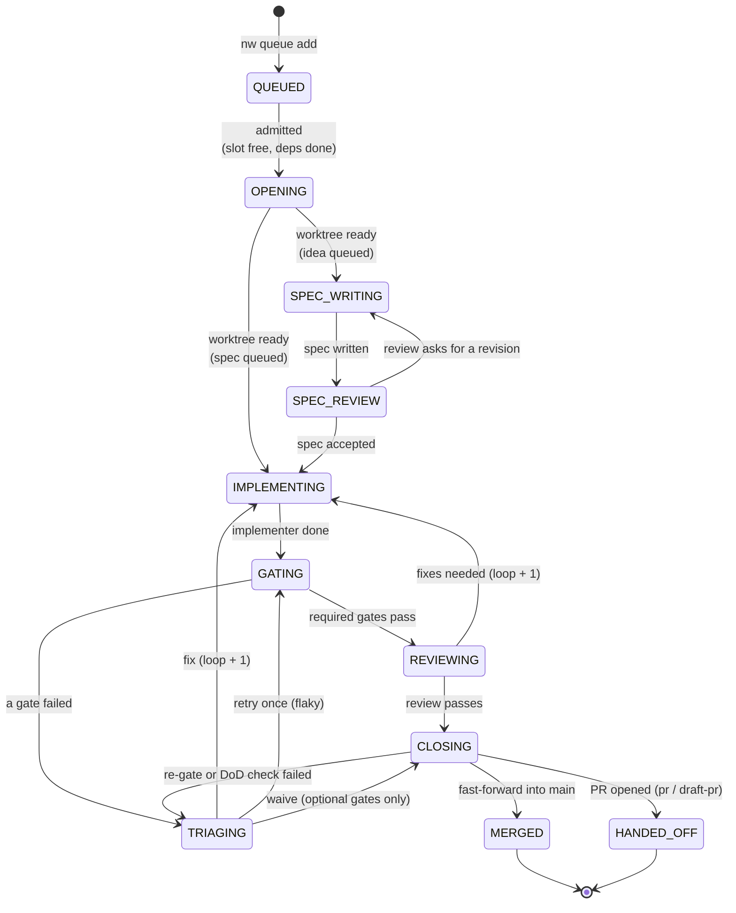
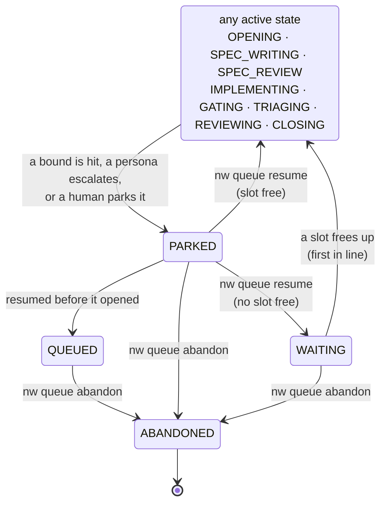
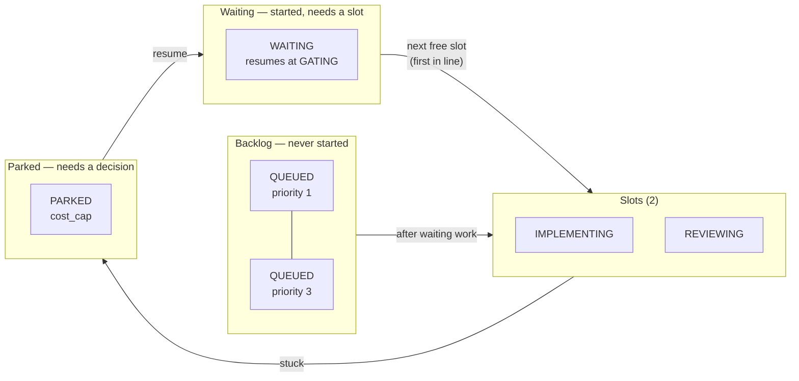

# The state machine

Every campaign is always in exactly one state. The runner moves it between states. The
rules are plain code (`nightwright.agentic.queue.plan_step` and friends), so the same inputs always
give the same move. The judgment calls (what code to write, whether a failure is real) happen
*inside* a state, in a persona run. The decision about which state comes next is
deterministic.

## The main path

Two loops go back to the implementer: a **failed gate** (through the triager) and a **review
that asks for fixes**. Each trip adds one to the campaign's loop count.

## Stopping and resuming

Any active campaign can stop and wait for a decision, and every stop names its reason. A
resumed campaign goes back to work if a slot is free, or waits first in line if not.

## Slots: who is "active"

A profile gives the queue a number of **slots** (`balanced`: 2). Only campaigns that are
open and delivering hold a slot: OPENING, SPEC_WRITING, SPEC_REVIEW, IMPLEMENTING, GATING,
TRIAGING, REVIEWING and CLOSING. That keeps three groups apart:

- **Started work finishes first.** When a slot frees up, a WAITING campaign takes it before
  anything new is admitted, so its branch doesn't go stale behind newer work.
- **The backlog** is admitted by priority, then age. An item is admitted only when every spec
  it `depends_on` is done on main.
- **Parked campaigns hold no slot.** They wait for a decision.

## Every state

| State | Group | What is happening | Leaves when |
|---|---|---|---|
| `QUEUED` | backlog | Accepted spec (or idea), not started | Admitted into a free slot (dependencies done) |
| `WAITING` | waiting | Started before, ready to continue, no slot free | A slot frees up; it resumes where it stopped |
| `OPENING` | active | Branch and worktree are being created; setup commands run | The worktree is ready |
| `SPEC_WRITING` | active | Idea campaigns only: the **spec writer** persona writes the spec from the idea, or revises it after a review | It reports the spec written |
| `SPEC_REVIEW` | active | Idea campaigns only: the **spec reviewer** reviews the spec; an approving review accepts it inside the loop | Approved (to IMPLEMENTING) or a revision is asked (back to SPEC_WRITING) |
| `IMPLEMENTING` | active | The **implementer** persona writes code against the spec and the last findings | It reports done (or blocked) |
| `GATING` | active | Your **gates** run in the worktree (tests, lint, …) | All required gates pass, or one fails |
| `TRIAGING` | active | The **gate triager** reads the failure and decides: fix, retry, waive or escalate | It decides |
| `REVIEWING` | active | The **conformance reviewer** checks the change against the spec's acceptance criteria | Pass, or a list of fixes |
| `CLOSING` | active | Rebase on main, re-run gates, check the spec wasn't changed and its Definition of Done holds, then merge or open a PR | Merged, handed off, back to TRIAGING (a check failed), or parked |
| `PARKED` | parked | Stopped with a **reason**, waiting for a decision | `nw queue resume` (to the right state) or `abandon` |
| `MERGED` | done | Fast-forwarded into main. An outbound spec then has its status pulled back into the outbox, ledgered as an `outbound_pulled` event | — |
| `HANDED_OFF` | done | A PR is open for a human to merge. An outbound spec is pulled when the PR sweep records the merge | — |
| `ABANDONED` | done | Given up; worktree removed | — |

Park reasons, and what to do about each, are in **[Operating the loop](operate.md#when-something-parks)**.

## Loops are counted

Each trip back to IMPLEMENTING (a triage `fix`, or a review asking for fixes) adds one to
`loops`. The profile caps it (`balanced`: 3). On the next one the campaign parks
`loop_exhausted` instead of trying forever. See
**[Convergence and escalation](convergence.md)**.

## Campaigns that start from an idea

`nw queue add IDEA-NNN` queues an idea instead of an accepted spec. After OPENING the
campaign passes through **SPEC_WRITING** and **SPEC_REVIEW** (as many rounds as the profile
allows) before it reaches IMPLEMENTING. Campaigns queued from an accepted spec skip both
states. See the [ideas-to-specs](../ideas/index.md) workflow.
